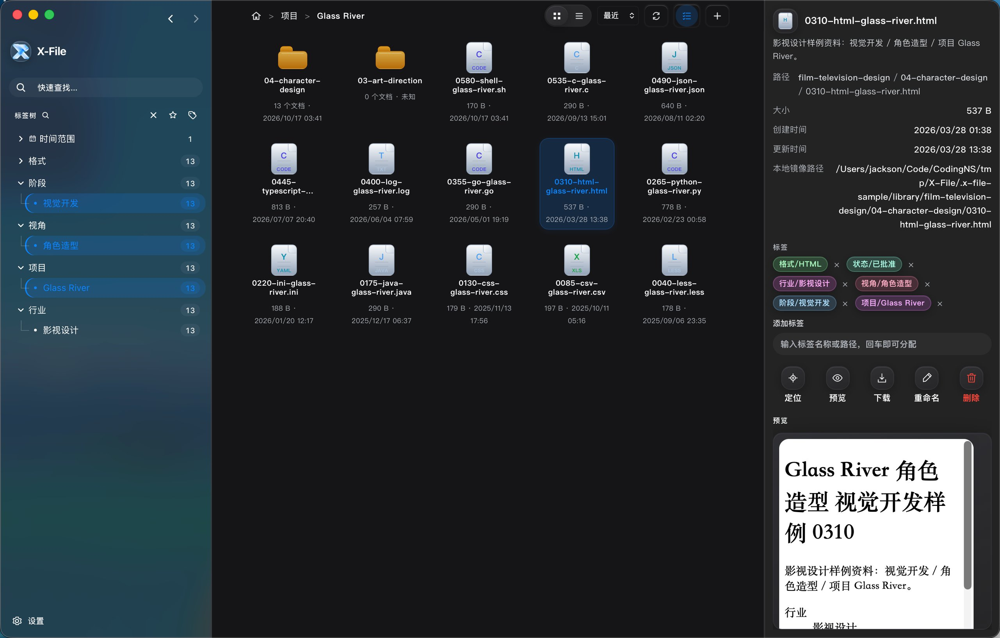
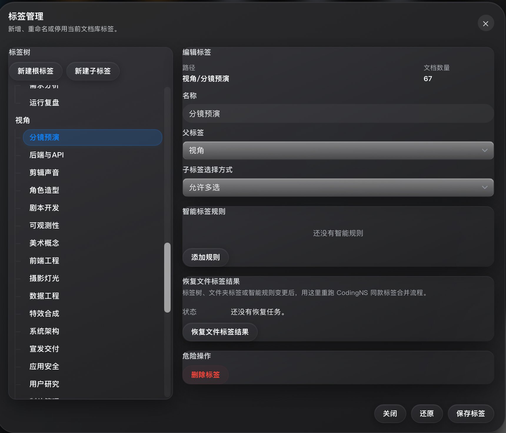
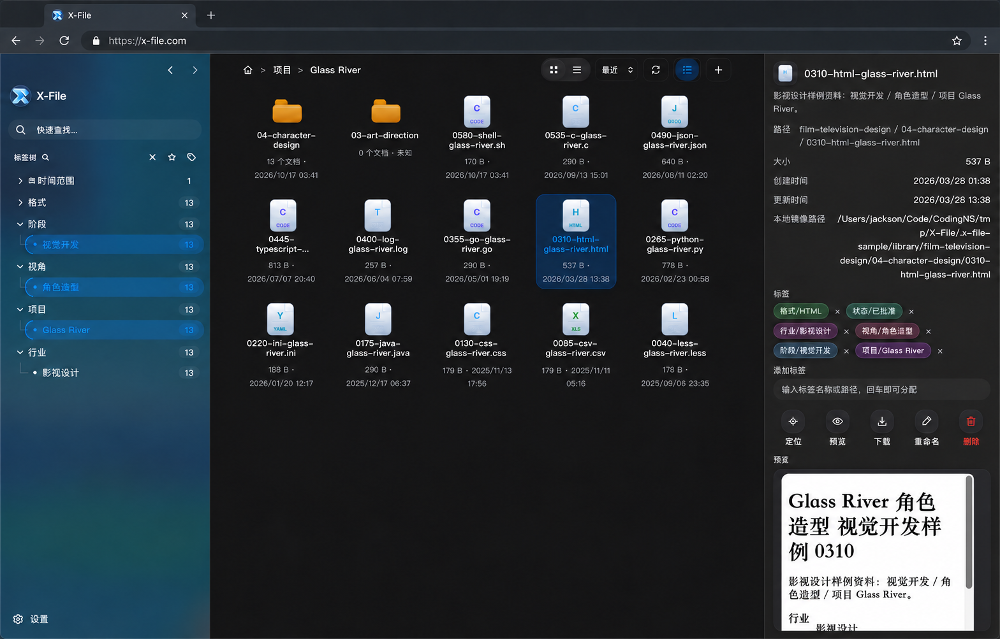
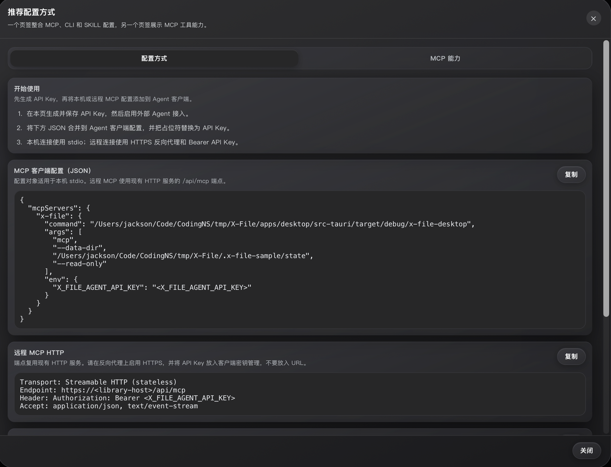

# X-File

**Smart indexing, instant discovery. Every document at your fingertips.**

X-File is a cross-platform document management application built with Tauri 2, React, and a native Rust indexing engine. Organize your local files with a flexible tag tree system, turn your document library into a web NAS, and integrate external AI agents for intelligent document management.

[中文文档](./README.zh-CN.md) | [Documentation](./docs/) | [Download](https://github.com/jingyi0605/X-File/releases/latest)

---



---

## ✨ Key Features

### 🏷️ Supertag Tree Management

Organize documents with a flexible tag hierarchy instead of rigid folder structures. A single file can belong to multiple business categories simultaneously (e.g., "2024 / Finance / Pending Review"). Adjust tag levels to match any industry's classification logic and instantly filter files from any tag combination.



### 📁 Direct Local File Access

Read and display files directly from your local disk without importing or copying. No separate file management sandbox—your original files stay in their original locations. Index and source files are separate; deleting the index doesn't affect your files. Automatically syncs index status when files change.

### 🌐 One-Click Web NAS

Launch the HTTP service and access your document library from any device's browser on the LAN. No need to install clients on every device. Supports file preview, download, search, and tag filtering. Configure username and password to secure LAN access.



### 🔄 Cross-Platform Tag Sync

Desktop applications for macOS, Windows, and Linux. Sync tag data across platforms (via mirror mode connecting to remote instances). Web and desktop share the same tag system. Mark files on any device, and tag status syncs to all other devices in real-time.

### 🤖 AI Agent Integration

Integrate external AI agents (like Claude, ChatGPT) for document management. AI can help you: auto-classify documents, intelligently tag, semantic search, and summarize. Exposes 28+ native tools via CLI/MCP protocol for agents to call. Supports custom AI workflows to manage documents according to your business logic.



---

## 🚀 Quick Start

### Installation

Current version: **v0.1.0**. For other versions, see [Releases](https://github.com/jingyi0605/X-File/releases).

| Platform | Architecture | Download |
|---|---|---|
| macOS | Universal (Intel + Apple Silicon) | [X-File_0.1.0_universal.dmg](https://github.com/jingyi0605/X-File/releases/download/v0.1.0/X-File_0.1.0_universal.dmg) |
| Windows | x64 | [X-File_0.1.0_x64-setup.exe](https://github.com/jingyi0605/X-File/releases/download/v0.1.0/X-File_0.1.0_x64-setup.exe)<br>[X-File_0.1.0_x64_en-US.msi](https://github.com/jingyi0605/X-File/releases/download/v0.1.0/X-File_0.1.0_x64_en-US.msi) |
| Linux | x86_64 | [X-File_0.1.0_amd64.AppImage](https://github.com/jingyi0605/X-File/releases/download/v0.1.0/X-File_0.1.0_amd64.AppImage)<br>[X-File_0.1.0_amd64.deb](https://github.com/jingyi0605/X-File/releases/download/v0.1.0/X-File_0.1.0_amd64.deb)<br>[X-File-0.1.0-1.x86_64.rpm](https://github.com/jingyi0605/X-File/releases/download/v0.1.0/X-File-0.1.0-1.x86_64.rpm) |

### First Launch

1. Open X-File and add your first document library
2. Wait for the initial indexing to complete
3. Start organizing with tags or search for documents

### Web Access

1. Go to **Settings → HTTP Service** and enable it
2. Optionally configure LAN access with username/password
3. Access from any browser: `http://your-computer-ip:17321`

---

## 🛠️ For Developers

### Prerequisites

- Node.js >= 20.11.0
- pnpm >= 9.0.0
- Rust and Tauri 2 system dependencies

### Build from Source

```bash
# Install dependencies
pnpm install

# Build all packages
pnpm build

# Type checking
pnpm typecheck
```

### Development

```bash
# Start desktop app (recommended)
pnpm dev:desktop

# Start backend only
pnpm dev:server

# Start frontend only (requires backend running)
pnpm dev:web
```

### Testing

```bash
# Run Rust tests
cargo test --manifest-path apps/desktop/src-tauri/Cargo.toml --lib

# Benchmark indexing performance (10k files, 100 dirs)
pnpm benchmark:index -- --files 10000 --dirs 100
```

### Packaging

```bash
# Package for current platform
pnpm package:desktop

# Package for specific platform
pnpm package:desktop:macos
pnpm package:desktop:windows
pnpm package:desktop:linux
```

---

## 📚 Documentation

- [CodingNS Integration Guide](./docs/20260608-CodingNS接入X-File说明.md)
- [External Agent Integration](./docs/20261026-外部Agent工具接入说明.md)
- [Desktop Packaging and Release](./docs/)
- [Frontend Development Standards](./docs/20260609-前端开发规范.md)

---

## 🏗️ Architecture

```
x-file/
├── apps/
│   ├── desktop/       # Tauri 2 desktop shell
│   ├── server/        # Fastify backend (HTTP APIs)
│   └── web/           # React frontend
├── packages/
│   ├── indexer/       # Native CLI client
│   └── shared/        # Shared TypeScript types
├── docs/              # Documentation
├── scripts/           # Build and dev scripts
└── specs/             # Feature specifications
```

### Tech Stack

- **Frontend**: React + TypeScript + Vite
- **Backend**: Fastify + TypeScript
- **Desktop**: Tauri 2
- **Indexing Engine**: Rust (native)
- **Search**: Custom inverted index with 16-partition sharding

---

## 🌏 Platform Support

| Platform | Architecture | Status |
|----------|--------------|--------|
| macOS    | Universal (Intel + Apple Silicon) | ✅ Supported |
| Windows  | x86_64       | ✅ Supported |
| Linux    | x86_64       | ✅ Supported |

---

## 🔄 Updates

X-File supports automatic updates with two channels:

- **Stable**: Production-ready releases (`0.2.0`)
- **Beta**: Preview releases with latest features (`0.2.0-beta.1`)

Updates are served via GitHub Releases with optional China mirror fallback for faster downloads.

---

## 📄 License

X-File is released under the [MIT License](./LICENSE).

---

## 🤝 Feedback

Bug reports and feature requests are welcome in [GitHub Issues](https://github.com/jingyi0605/X-File/issues).

---

**Made with ❤️ by the X-File Team**
