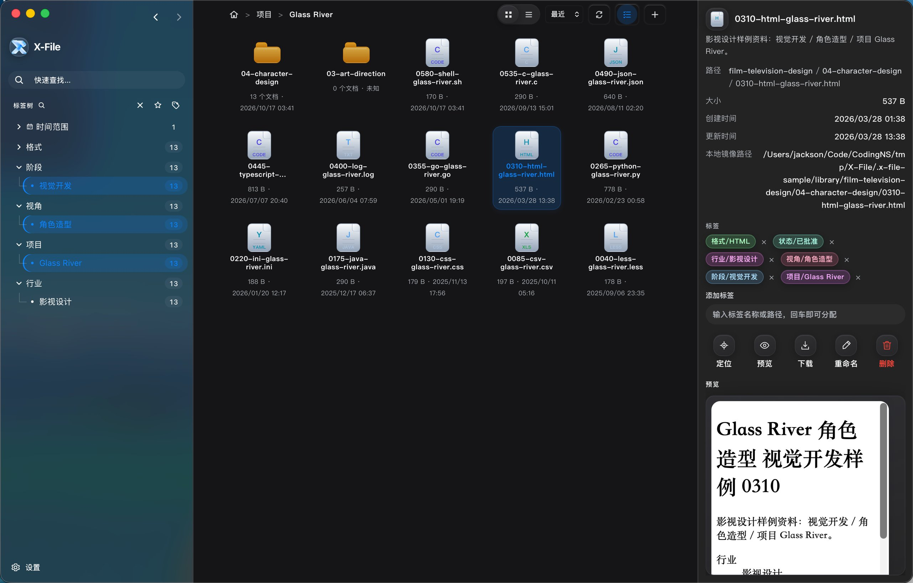
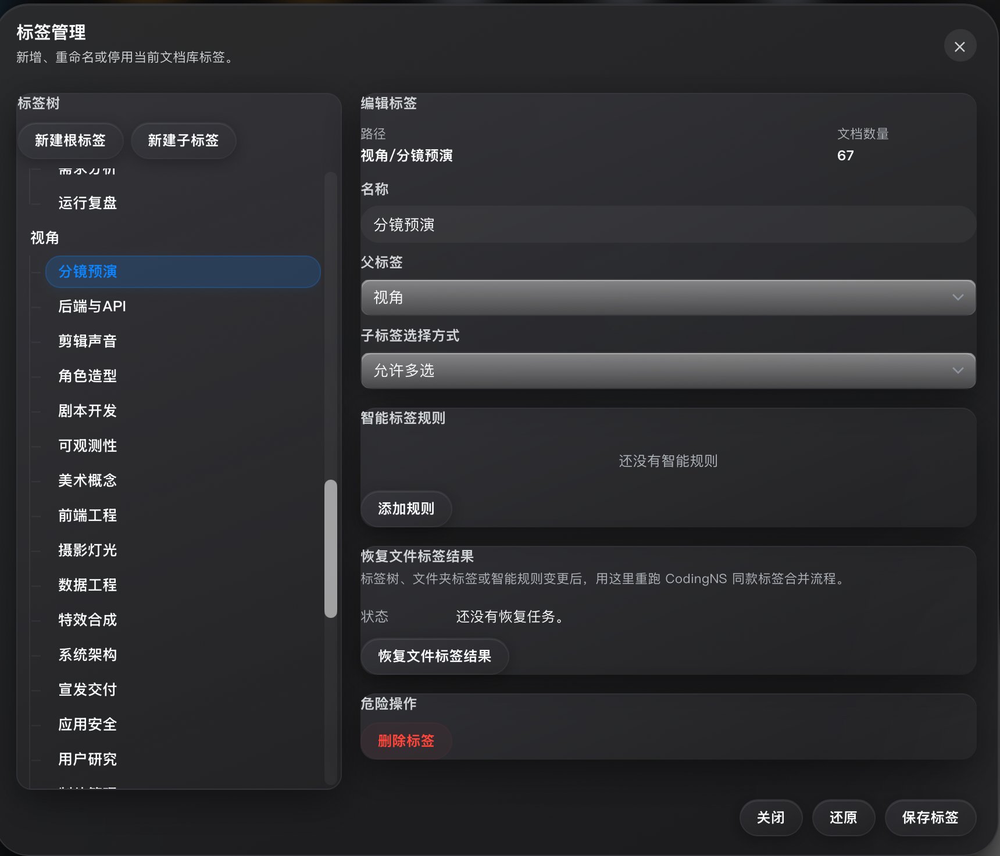
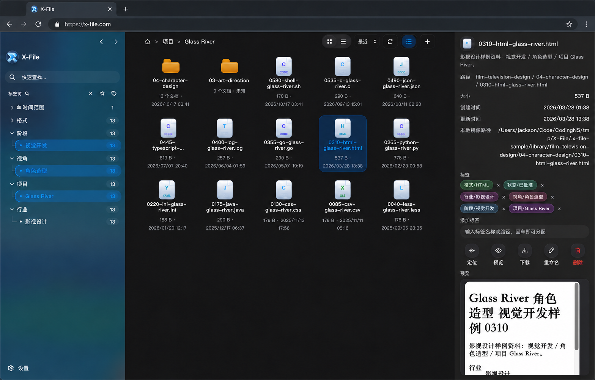
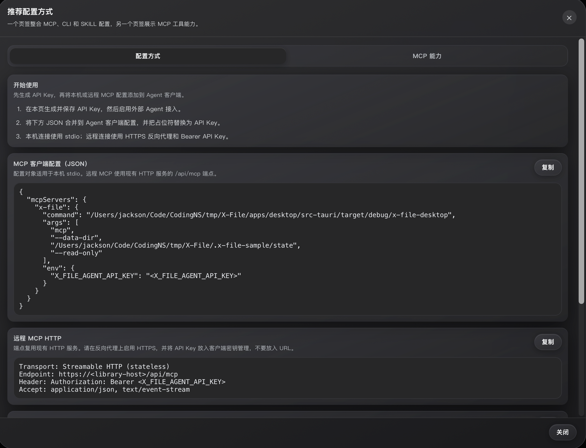

# X-File

[](https://github.com/jingyi0605/X-File/releases/latest) [](https://github.com/jingyi0605/X-File/releases/latest) [](./LICENSE)

**智能索引，即时发现。让每一份文档都触手可及。**

X-File 是一个跨平台文档管理应用，使用 Tauri 2、React 和 Rust 原生索引引擎构建。通过灵活的标签树系统组织本地文件，将文档库变身 Web NAS，并集成外部 AI Agent 进行智能文档管理。

[English](./README.md) | [文档](./docs/) | [下载](https://github.com/jingyi0605/X-File/releases/latest)

---



---

## ✨ 核心特性

### 🏷️ Supertag 标签树管理

用灵活的标签层级组织文档，不再受限于僵化的文件夹结构。一个文件可以同时属于多个业务分类（如"2024年 / 财务 / 待审核"）。标签层级可以灵活调整，适配任何行业的分类逻辑，从任意标签组合瞬间筛选出目标文件。



### 📁 直接管理本地文件

直接读取和显示本地磁盘中的文件，无需导入或复制。不建立独立的文件管理沙盒，原文件保持在原位置。索引与原文件分离，删除索引不影响原文件。支持监听文件变化，自动同步索引状态。

### 🌐 一键变身 Web NAS

启动 HTTP 服务，局域网内任何设备通过浏览器直接访问你的文档库。无需在每台设备安装客户端。支持文件预览、下载、搜索、标签筛选。可配置用户名密码，保护局域网访问安全。



### 🔄 跨平台标签同步

桌面应用支持 macOS、Windows、Linux。标签数据跨平台同步（通过镜像模式连接远程实例）。Web 端与桌面端标签体系完全一致。在任意设备标记文件，其他设备实时同步标签状态。

### 🤖 AI Agent 智能辅助

集成外部 AI Agent（如 Claude、ChatGPT 等）进行文档管理。AI 可以帮你：自动分类文档、智能打标签、语义搜索、总结文档。通过 CLI/MCP 协议暴露 28+ 原生工具供 Agent 调用。支持自定义 AI 工作流，让 Agent 按你的业务逻辑管理文档。



---

## 🚀 快速开始

### 安装

前往 **[最新版本](https://github.com/jingyi0605/X-File/releases/latest)** 下载适合你平台的安装包。

| 平台 | 架构 | 安装包 |
|---|---|---|
| macOS | Universal（Intel + Apple Silicon） | `.dmg` |
| Windows | x64 | `-setup.exe`（推荐）或 `.msi` |
| Linux | x86_64 | `.AppImage`、`.deb` 或 `.rpm` |

历史版本和 Beta 版本见 [Releases](https://github.com/jingyi0605/X-File/releases) 页面。

### 首次启动

1. 打开 X-File，添加你的第一个文档库
2. 等待初始索引完成
3. 开始用标签组织文档，或搜索文档

### Web 访问

1. 进入 **设置 → HTTP 服务**，启用服务
2. 可选配置局域网访问的用户名和密码
3. 从任意浏览器访问：`http://你的电脑IP:17321`

---

## 🛠️ 开发者指南

### 环境要求

- Node.js >= 20.11.0
- pnpm >= 9.0.0
- Rust 和 Tauri 2 系统依赖

### 从源码构建

```bash
# 安装依赖
pnpm install

# 构建所有包
pnpm build

# 类型检查
pnpm typecheck
```

### 开发

```bash
# 启动桌面应用（推荐）
pnpm dev:desktop

# 只启动后端
pnpm dev:server

# 只启动前端（需要后端已运行）
pnpm dev:web
```

### 测试

```bash
# 运行 Rust 测试
cargo test --manifest-path apps/desktop/src-tauri/Cargo.toml --lib

# 索引性能基准测试（1万文件，100个目录）
pnpm benchmark:index -- --files 10000 --dirs 100
```

### 打包

```bash
# 打包当前平台
pnpm package:desktop

# 打包指定平台
pnpm package:desktop:macos
pnpm package:desktop:windows
pnpm package:desktop:linux
```

---

## 📚 文档

- [CodingNS 集成指南](./docs/20260608-CodingNS接入X-File说明.md)
- [外部 Agent 接入说明](./docs/20261026-外部Agent工具接入说明.md)
- [桌面打包与发布](./docs/)
- [前端开发规范](./docs/20260609-前端开发规范.md)

---

## 🏗️ 架构

```
x-file/
├── apps/
│   ├── desktop/       # Tauri 2 桌面壳
│   ├── server/        # Fastify 后端（HTTP APIs）
│   └── web/           # React 前端
├── packages/
│   ├── indexer/       # 原生 CLI 客户端
│   └── shared/        # 共享 TypeScript 类型
├── docs/              # 文档
├── scripts/           # 构建和开发脚本
└── specs/             # 功能规格说明
```

### 技术栈

- **前端**: React + TypeScript + Vite
- **后端**: Fastify + TypeScript
- **桌面**: Tauri 2
- **索引引擎**: Rust（原生）
- **搜索**: 自定义倒排索引，16 分区分片

---

## 🌏 平台支持

| 平台     | 架构                          | 状态      |
|----------|-------------------------------|-----------|
| macOS    | Universal (Intel + Apple Silicon) | ✅ 支持   |
| Windows  | x86_64                        | ✅ 支持   |
| Linux    | x86_64                        | ✅ 支持   |

---

## 🔄 更新

X-File 支持自动更新，提供两个通道：

- **Stable**：稳定版本（如 `0.2.0`）
- **Beta**：预览版本，包含最新特性（如 `0.2.0-beta.1`）

更新通过 GitHub Releases 分发，可选中国镜像回退以加速下载。

---

## 📄 许可证

X-File 基于 [MIT 许可证](./LICENSE) 发布。

---

## 🤝 反馈

问题反馈和功能建议请提交到 [GitHub Issues](https://github.com/jingyi0605/X-File/issues)。

---

**X-File 团队用 ❤️ 打造**
